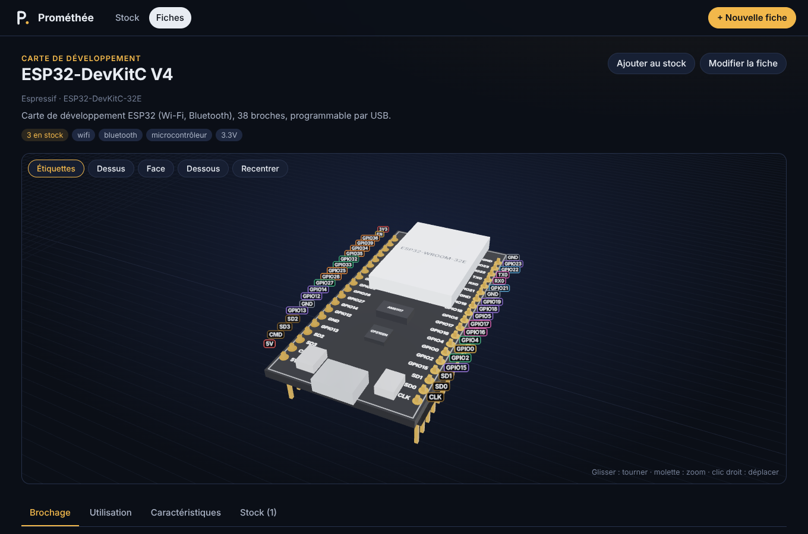
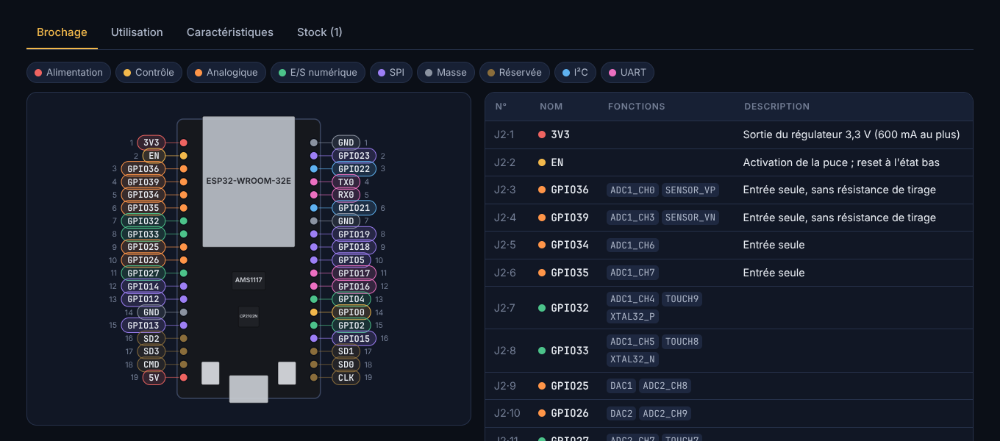

<p align="center"></p>

# Prométhée — stock électronique et fiches techniques en 3D

> Un conteneur Docker pour suivre son stock de composants et de cartes, avec pour chaque appareil
> une fiche en Markdown : vue 3D interactive, brochage, caractéristiques et mode d'emploi.

[](https://github.com/astraeos-dev/Promethee/actions/workflows/tests.yml)
[](LICENSE)


<a href="https://buymeacoffee.com/gregorychau"></a>

**Installer** : `docker compose up -d`, puis ouvrir <http://localhost:8080>. Une idée, un problème ?
[Ouvrir une demande](https://github.com/astraeos-dev/Promethee/issues/new/choose).

**Projet actif** · un des projets d'Astraeos : [site web](https://astraeos-dev.github.io/personnal-site/)

---

<p align="center"></p>

## Présentation

Un atelier d'électronique accumule vite des centaines de références : résistances, capteurs,
cartes de développement. Prométhée répond à deux questions : *combien m'en reste-t-il, et où ?*
et *comment se branche cet appareil ?*

Le stock vit dans une base SQLite, avec l'historique de chaque entrée et sortie. La documentation
vit dans des **fichiers texte, un par appareil**, rangés dans le dossier `fiches/` : on les écrit
dans n'importe quel éditeur, on les versionne avec Git, on les partage. L'interface les relit à
chaque affichage et en tire une vue 3D, un schéma de brochage et un tableau des broches, reliés
entre eux : survoler une broche l'éclaire partout.

Tout fonctionne hors ligne : Three.js est inclus dans l'image, aucune ressource n'est chargée
depuis Internet.

## Fonctionnalités

- **Stock** : quantités, emplacement, seuil d'alerte, fournisseur, prix ; boutons + et − ;
  historique des mouvements ; recherche et filtres ; import et export CSV (compatible tableur).
- **Fiches techniques** : un fichier Markdown avec en-tête YAML par appareil, créé à la main ou
  depuis l'éditeur intégré (aperçu 3D en direct, erreurs signalées ligne par ligne).
- **Vue 3D** : générée à partir du boîtier et du brochage décrits dans la fiche (cartes, modules,
  DIP, TO-92), avec noms sérigraphiés, étiquettes, vues de dessus, de face et de dessous ;
  ou modèle réel importé en `.glb`, `.gltf` ou `.stl`.
- **Brochage** : schéma 2D et tableau colorés par type (alimentation, I²C, SPI, UART…),
  avec fonctions alternatives et précautions ; filtre par type.
- **Utilisation** : texte libre en Markdown (câblage, code, formules), caractéristiques et liens
  vers les datasheets.
- **Lien stock ↔ fiche** : chaque article peut pointer vers sa fiche, qui affiche la quantité en stock.

<p align="center"></p>

## Installation

Prérequis : Docker avec Compose v2.

```bash
git clone https://github.com/astraeos-dev/Promethee.git
cd Promethee
docker compose up -d
```

L'interface répond sur <http://localhost:8080>. Deux dossiers du dépôt sont montés dans le conteneur :

| Dossier    | Contenu                                                   |
|------------|-----------------------------------------------------------|
| `fiches/`  | un fichier `.md` par appareil, et `modeles/` pour les modèles 3D |
| `base/`    | la base SQLite du stock (`stock.sqlite3`), à sauvegarder  |

Sous Linux, si votre identifiant n'est pas 1000, lancez `UID=$(id -u) GID=$(id -g) docker compose up -d`
pour que les fichiers créés vous appartiennent.

Sans Compose :

```bash
docker build -t promethee .
docker run -d -p 8080:8000 -v promethee-fiches:/donnees/fiches -v promethee-base:/donnees/base promethee
```

Avec un volume vide, les fiches d'exemple sont copiées au premier démarrage.

## Utilisation

```bash
docker compose up -d          # démarrer
docker compose logs -f        # suivre les journaux
docker compose up -d --build  # mettre à jour après un git pull
```

### Créer une fiche à la main

Copier `fiches/_modele.md` sous un nouveau nom, par exemple `fiches/relais-5v.md`, le compléter,
puis recharger la page **Fiches**. Le format complet est décrit dans
[docs/format-fiche.md](docs/format-fiche.md). Extrait :

```yaml
---
nom: NE555
categorie: Circuit intégré
boitier: { type: dip, longueur: 10.16, largeur: 7.62, marquage: NE555P }
brochage:
  rangees:
    - cote: gauche
      broches:
        - { n: 1, nom: GND, type: masse }
        - { n: 2, nom: TRIG, type: controle, desc: "Déclenchement sous 1/3 de VCC" }
---

## Montage astable
Fréquence : **f = 1,44 / ((R1 + 2·R2) · C)**
```

### Fiches fournies

ESP32-DevKitC V4, Arduino Nano, NE555, module BME280 et transistor PN2222A.

### Import CSV

Colonnes reconnues : `id`, `nom`, `categorie`, `valeur`, `boitier`, `fiche`, `quantite`, `seuil`,
`emplacement`, `fournisseur`, `prix`, `notes`. Séparateur `;`, `,` ou tabulation. Une ligne dont
l'`id` existe met l'article à jour, les autres créent un article.

### API

L'API REST est documentée sur <http://localhost:8080/api/docs>.

## Configuration

| Variable             | Défaut             | Rôle                                   |
|----------------------|--------------------|----------------------------------------|
| `PROMETHEE_FICHES`   | `/donnees/fiches`  | dossier des fiches                     |
| `PROMETHEE_DATA`     | `/donnees/base`    | dossier de la base SQLite              |
| `PROMETHEE_MODELE_MAX` | `31457280`       | taille maximale d'un modèle 3D (octets) |

## Limites

- Pas de comptes utilisateurs : à réserver au réseau local, ou à placer derrière un
  reverse proxy avec authentification.
- La vue 3D générée est schématique : elle place les broches et les principaux composants,
  mais ne remplace pas un modèle exporté d'un logiciel de CAO.
- Les boîtiers CMS (SOIC, QFN…) ne sont pas encore générés : utiliser `module` ou un modèle importé.
- Le texte des fiches accepte le HTML brut du Markdown : ne pas ouvrir l'éditeur à des inconnus.

## Développement

```bash
python -m venv .venv && . .venv/bin/activate
pip install -r requirements-dev.txt
pytest                                   # tests
uvicorn app.main:app --reload            # http://localhost:8000
```

Structure : `app/` (API FastAPI, stock SQLite, lecture des fiches), `app/static/` (interface en
JavaScript sans framework), `fiches/` (fiches d'exemple), `tests/`.

## Sources et crédits

- [Three.js](https://threejs.org) r170, MIT, inclus dans `app/static/vendor/three/`.
- [FastAPI](https://fastapi.tiangolo.com), [Uvicorn](https://www.uvicorn.org), [PyYAML](https://pyyaml.org),
  [Python-Markdown](https://python-markdown.github.io) : MIT ou BSD.
- Brochages établis d'après les documentations d'Espressif, Arduino, Texas Instruments, Bosch
  Sensortec et onsemi, citées dans chaque fiche.

## Licence

MIT, voir [LICENSE](LICENSE).
